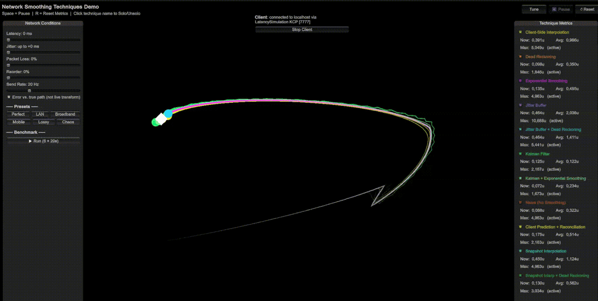

# ClientSmoothing

A Unity demo that compares client-side network smoothing techniques against one authoritative moving entity, and measures how well each one holds up under different network conditions.

**Unity 6000.3** · Networking by [Mirror](https://github.com/MirrorNetworking/Mirror) (included under `Assets/Mirror`)

- [Techniques](#techniques)
- [Scenes](#scenes)
- [Running it](#running-it)
- [Controls](#controls)
- [Network presets](#network-presets)
- [How error is measured](#how-error-is-measured)
- [Benchmark](#benchmark)

## Techniques

Each technique renders as a coloured dot with a trail; the white diamond is the server.

| Technique | Idea |
|---|---|
| Naive | Snap to the latest snapshot |
| Exponential Smoothing | Low-pass the received position |
| Client-Side Interpolation | Chase the latest snapshot with a fixed lerp speed |
| Snapshot Interpolation (+ Dead Reckoning) | Render slightly in the past between two buffered snapshots; the hybrid extrapolates when the buffer runs dry |
| Jitter Buffer (+ Dead Reckoning) | Sorted buffer with an adaptive playback clock; same fallback |
| Dead Reckoning | Extrapolate with the last velocity and blend toward corrections |
| Kalman (+ Exponential Smoothing) | Per-axis Kalman filter, optionally smoothed again for rendering |
| Client Prediction + Reconciliation | Extrapolate from the last confirmed state and blend toward it (automatic path only; clients do not send inputs) |

## Scenes

Both live in `Assets/Scenes`, are supported, and are benchmarked.

| Scene | What it is |
|---|---|
| **MirrorNetwork** | Real Mirror networking over KCP, wrapped in Mirror's `LatencySimulation`. The server entity is a prefab spawned by `DemoNetworkManager`. |
| **SimulatedNetwork** | A single process with no Mirror networking. A scene-placed server feeds `NetworkSimulator`, which fakes latency, jitter, loss and reordering. |

Both scenes measure error the same way ([see below](#how-error-is-measured)), so results are comparable, although the loss models differ (KCP vs. the simulator's random drop).

## Running it

**SimulatedNetwork:** open the scene and press Play.

**MirrorNetwork** can run two ways:

1. **Host + client in one editor** (Mirror's host button). The local connection bypasses the transport, so there is no latency, loss or unreliable delivery. Fine for a quick look, not for measuring.
2. **Host in one editor, client in a second process** (recommended). With [ParrelSync](https://github.com/VeriorPies/ParrelSync), create a clone, start the host in the main editor and connect the client in the clone (KCP, `localhost:7777`). Run benchmarks from the client.

ParrelSync notes:
- A clone only recompiles when its window is focused. Host and client must run the same code, or SyncVar and spawn layouts break.
- `Assets/Plugins/ParrelSync/` is git-ignored; install it yourself.

## Controls

- `Space` pauses (disabled on a remote client: it would only freeze the local view while the server keeps moving). `R` resets the metrics.
- The on-screen panel shows per-technique error, lets you hide techniques, and has sliders for latency, jitter, loss, reorder and send rate, plus presets.
- **Tune** (top bar) opens live sliders for the selected technique's parameters. They are found by reflection from its `[Range]` floats and public bools, so new techniques get them automatically. There is a reset to the startup values; changes are local to the running client.
- In Mirror the server owns the network conditions. A client changes them through a command (sent at most every 0.1 s while dragging) and every client sees the same values, including changes made by another peer or by a benchmark.
- The mode is detected automatically: simulator, Mirror offline, dedicated server, host or client. Server speed / back-move / player-controlled are only shown where the server runs (they are not synced). A dedicated server has no client, so it shows no metrics and cannot run the benchmark. Conditions are locked while a benchmark runs.

## Network presets

| Preset | Latency | Jitter | Loss | Send rate |
|---|---|---|---|---|
| Perfect | 0 ms | 0 ms | 0% | 20 Hz |
| LAN | 10 ms | 5 ms | 0% | 20 Hz |
| Broadband | 80 ms | 20 ms | 2% | 20 Hz |
| Mobile | 150 ms | 60 ms | 5% | 10 Hz |
| Lossy | 200 ms | 100 ms | 15% | 10 Hz |
| Chaos | 300 ms | 150 ms | 25% | 5 Hz |

Presets with loss also enable a small amount of reordering (2%).

## How error is measured

**Reference.** The server stamps snapshots with its own clock. The client rebases them onto its local clock using the least-delayed packet it has seen, so the minimum one-way latency is not counted as error. The server also streams its exact position at 60 Hz (metrics only); the client keeps about 3 s of that history and compares each technique with the true position at the matching local time. The simulator scene builds the same history, shifted by the minimum latency. The toggle "Error vs. true path" falls back to the live server transform.

**Delivery.** Snapshots are sent unreliably; stale or reordered ones are dropped in both scenes. The Reorder slider copies Mirror's `LatencySimulation` scramble: a scrambled packet is inserted at a random place in the delivery queue, so it only changes the order when several packets become ready in the same frame (rare at 5-20 Hz).

**Metrics**

| Metric | Meaning |
|---|---|
| Error (`mean`, `p95`, `max`) | Distance to the true position at the same local time |
| Delay-adjusted error (`adj_mean`, `adj_p95`) | Distance to the truth rewound by the delay a technique adds on purpose (buffer depth, or the lag of its smoothing chase), so deliberate buffering is not counted as error |
| Smoothness (`rms_dv`) | RMS of the frame-to-frame velocity change (units/s) |
| Stutters | Frames where the velocity change exceeds 15 units/s |
| Added delay | Buffer depth or smoothing lag in ms |
| Score | `adj_mean + 0.02 * rms_dv + 0.003 * added_delay_ms` (lower is better) |

The score weights are a judgement call, but the ranking is fairly robust to them (Kalman + Exponential Smoothing stays first overall unless delay is made free). The results window has sliders for both weights and an overall ranking (mean score over all presets); the CSV always uses the defaults.

## Benchmark

Runs every preset in turn (3 s settle, then 20 s of recording) on a seeded path, so runs are repeatable. Per technique it reports mean, p95 and max error, delay-adjusted mean/p95, smoothness, stutters, added delay and the snapshot rate received.

Results appear in a window (sorted by score) and are saved as CSV to `<persistentDataPath>/benchmarks/` (on Windows: `%USERPROFILE%\AppData\LocalLow\<company>\<product>\benchmarks\`).

- Keep old CSVs; they are the regression record. Only compare runs made with the same code version.
- Run-to-run noise on identical code is roughly 0.03-0.1 in score, so compare techniques relative to each other within a run rather than across runs.

### Sample results

MirrorNetwork, remote client over KCP, seed 12345. Overall is the mean score over all six presets. Lower is better.

| Preset | 1st | 2nd | 3rd |
|---|---|---|---|
| Perfect | Kalman + ES (0.15) | Snapshot Interp + DR (0.17) | Dead Reckoning (0.22) |
| LAN | Kalman + ES (0.16) | Snapshot Interp + DR (0.18) | Dead Reckoning (0.20) |
| Broadband | Kalman + ES (0.17) | Snapshot Interp + DR (0.23) | Dead Reckoning (0.29) |
| Mobile | Kalman + ES (0.38) | Snapshot Interp + DR (0.68) | Dead Reckoning (0.70) |
| Lossy | Kalman + ES (0.40) | Snapshot Interp + DR (0.68) | Dead Reckoning (0.71) |
| Chaos | Kalman + ES (1.21) | Dead Reckoning (1.33) | Snapshot Interp + DR (1.45) |

Overall: Kalman + ES 0.41, Snapshot Interp + DR 0.57, Dead Reckoning 0.58, Reconciliation 0.74, Kalman 0.77, Exponential Smoothing 0.96, Snapshot Interpolation 1.01, Client-Side Interpolation 1.08, Jitter Buffer + DR 1.22, Jitter Buffer 1.25, Naive 1.48.

Snapshot interpolation has the lowest adjusted error on clean links (about 0.004), but it stutters on lossy ones (100+ stutters per 20 s on Lossy and Chaos). Dead reckoning is the smoothest, at the price of a visible chase lag.
